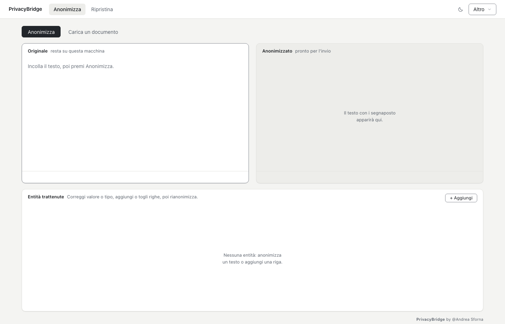
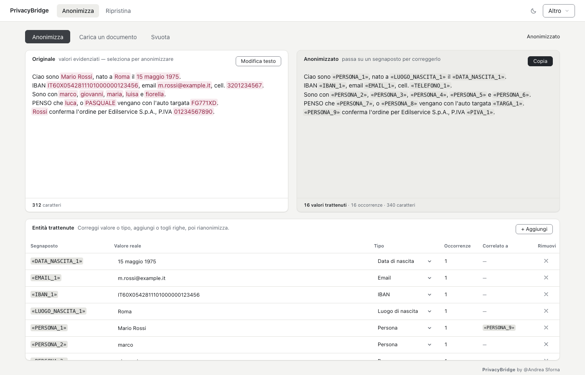
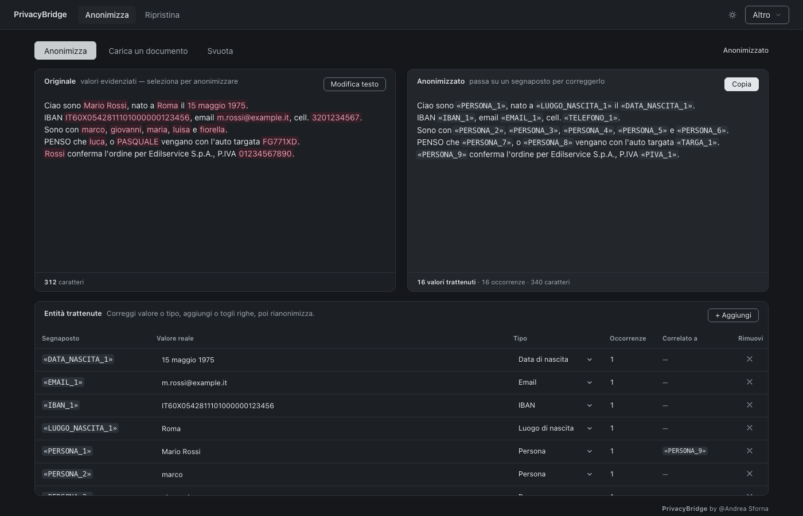

# PrivacyBridge

[](LICENSE)
[](src/avvio.py)
[](docs/MANUALE.md)
[](docs/MANUALE.md#cosa-non-fa)

Versione italiana: [README.md](README.md)

**Local-first, reversible anonymization for Italian texts and documents.**
It replaces names, IBANs, tax codes and contact details with placeholders, so the text can go
to a cloud AI assistant — and when the answer comes back, the original values are restored **byte for byte**.
No data ever leaves your computer.

> "Il sig. Mario Rossi, IBAN IT60X0542811101000000123456"
> becomes "Il sig. "PERSONA_1", IBAN "IBAN_1""

## How it works

1. **Anonymize** — paste text or load a document; the app replaces the sensitive data.
2. **Review** — check the *retained entities* table, correct or add entries, then **Copy**.
3. **Use AI** — paste the clean text into ChatGPT / Claude / Gemini and work normally.
4. **Restore** — paste the answer into the *Restore* tab: the real values go back in place.

Keep the app open between steps 2 and 4: the label-to-real-value mapping lives inside it.





*Screenshots with fictitious sample data (invented names, IBANs and contacts).*

## Try it in 5 minutes

**Option A — from source (works today, macOS and Windows).** Requirements: Python 3.11,
~2 GB free for the neural models (downloaded on first launch, then fully offline).

```bash
git clone https://github.com/Navras98/PrivacyBridge.git
cd PrivacyBridge
python3 -m venv venv && source venv/bin/activate   # Windows: venv\Scripts\activate
pip install -r requirements.txt
python -m spacy download it_core_news_sm
python src/avvio.py
```

On first launch it downloads the PII model weights from Hugging Face (`rizzo-pii-0.3B`,
MIT — see `NOTICE.txt`); from the second launch it works with no connection.
To verify everything works: `./verifica_tutto.sh`.

**Option B — ready macOS app.** The `PrivacyBridge.dmg` (2.3 GB, drag into
Applications) cannot live on GitHub — 100 MB per-file limit in the repo
and 2 GB per Release attachment — so the download will come via an external
link (Google Drive): added here as soon as ready.

## Features

- **100% local** — no telemetry, no cloud. The only connection (optional and
  disableable) is the update check at startup.
- **Exact reversibility** — `Restore(Anonymize(X)) == X`, byte for byte.
- **Real Italian** — first/last names, municipalities, tax codes (official formula), VAT
  (checksum), IBAN (mod-97), cards (Luhn), plates/VIN, deeds and protocols, emails, phones,
  addresses, health cards and ID documents. Full taxonomy (in Italian) in
  [docs/TASSONOMIA_PII.md](docs/TASSONOMIA_PII.md).
- **Documents** — PDF, DOCX, TXT, MD, CSV, EML, MSG, RTF, ODT, XLSX, HTML. Scanned pages
  go through the native system OCR (Vision on macOS, Windows OCR on Windows).
- **Six verifiable guarantees** — deterministic, never corrupts text, zero leaks on
  structured data, exact restore, consistent placeholders, never silent. Verified with
  `python tests/test_garanzie.py`.
- **Safety net** — entity table before copying + pre-copy scan for residual patterns
  asking for confirmation.
- **Encrypted vault** — real values rest encrypted at-rest (Fernet, key in the OS
  keychain) with 0600 file permissions. Full-disk encryption (FileVault / BitLocker)
  still recommended.

## Stated limits

Honesty first — the full chapter with measured numbers is in
[docs/CONSEGNA.md](docs/CONSEGNA.md) (in Italian):

- **It does not catch everything.** Recognition is very good but not perfect: always
  read the entity table before copying.
- **Scans (OCR).** On photographed PDFs detection is less reliable — the app warns
  and the table must be checked row by row.
- **Italian.** On other languages and rare foreign names it recognizes far less.
- **Windows** has not been tested on a real machine yet (portable code, Inno Setup
  script ready; see `BLOCCHI.md § 11`, in Italian).

## Tests

```bash
./verifica_tutto.sh        # full suite (engine, documents, guarantees, UI)
./verifica_tutto.sh --rapido
```

8 suites, 861 tests. Times measured on an Intel i7-8750H (CPU): ~7 s per 10,000 characters,
~2 min per 100,000. Details in [docs/MANUALE.md](docs/MANUALE.md#tempi-reali-misurati) (in Italian).

## Packages

- **macOS** — `PrivacyBridge.dmg` (drag into Applications; first launch with right-click → Open,
  unsigned Apple app). Recipe in `build/build_bundle.sh` + `build/*.spec`.
- **Windows** — installer to be built on a real Windows machine (`docs/BLOCCHI.md` §11,
  `build/PrivacyBridge-windows.iss`). We do not ship untested exes: there is no
  prebuilt one in this repo.

Full user guide (in Italian): [docs/MANUALE.md](docs/MANUALE.md).

## Layout

```
src/          avvio.py, api/ (FastAPI + UI), backend/ (engine, vault, OCR), data/liste/
tests/        engine, taxonomy, adversarial, documents+OCR, guarantees, UI
benchmark/    measurement code only (private documents stay out of git)
docs/         MANUALE, CONSEGNA, DECISIONI, BLOCCHI, PROGRESSO, screenshots/ (Italian)
scripts/      name lists, final gate, screenshots, contrasts
assets/       icons + list sources   build/  .spec/.sh/.iss recipes (bundle excluded)
```

## Contact

Andrea Sforna — andrea.sforna@gmail.com — https://github.com/Navras98

Feedback, bug reports and ideas are welcome as GitHub issues.

## License

MIT — © 2026 Andrea Sforna. See [LICENSE](LICENSE).
Third parties (neural model, dictionaries, spaCy, Presidio) in [NOTICE.txt](NOTICE.txt).
